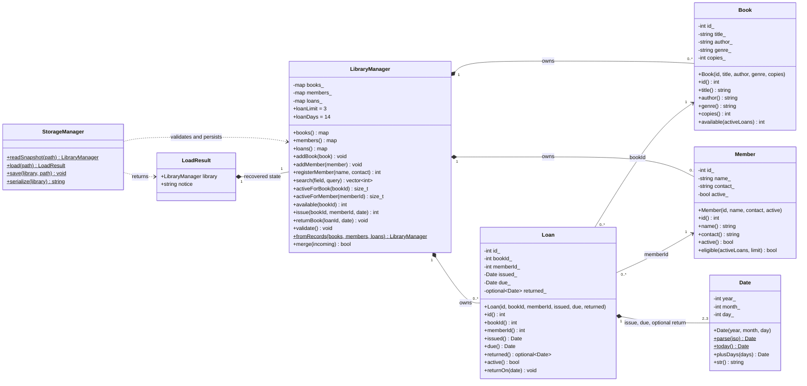

# UML class diagram

This diagram follows the public APIs and private state in `include/`.
Only the manager owns entities; loans store IDs, not raw pointers or copies of members/books.

`$` denotes a static method. String/date/map getters in C++ return const references
where applicable; the diagram abbreviates these signatures for readability.
Collection multiplicities describe logical ownership within each library instance.
Book/member associations are enforced by manager validation, including for returned
loans. Dates are value objects; a loan owns two required dates and an optional return
date. The free `operator<` compares Date values. `main.cpp` orchestrates the manager
and storage without introducing a domain dependency on terminal interaction.
